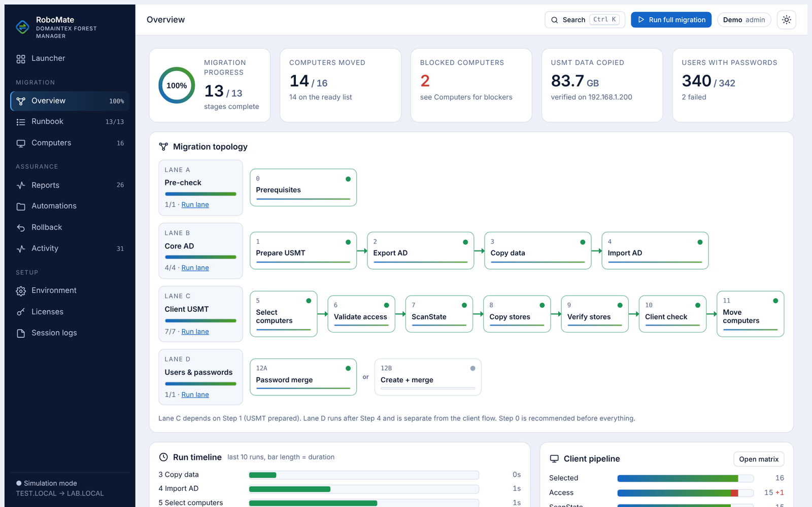
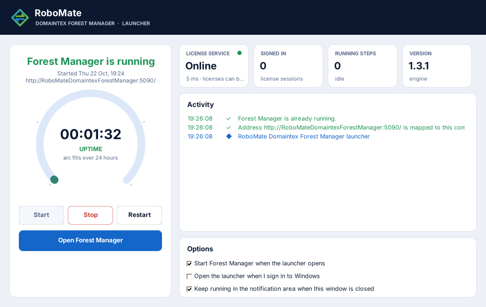
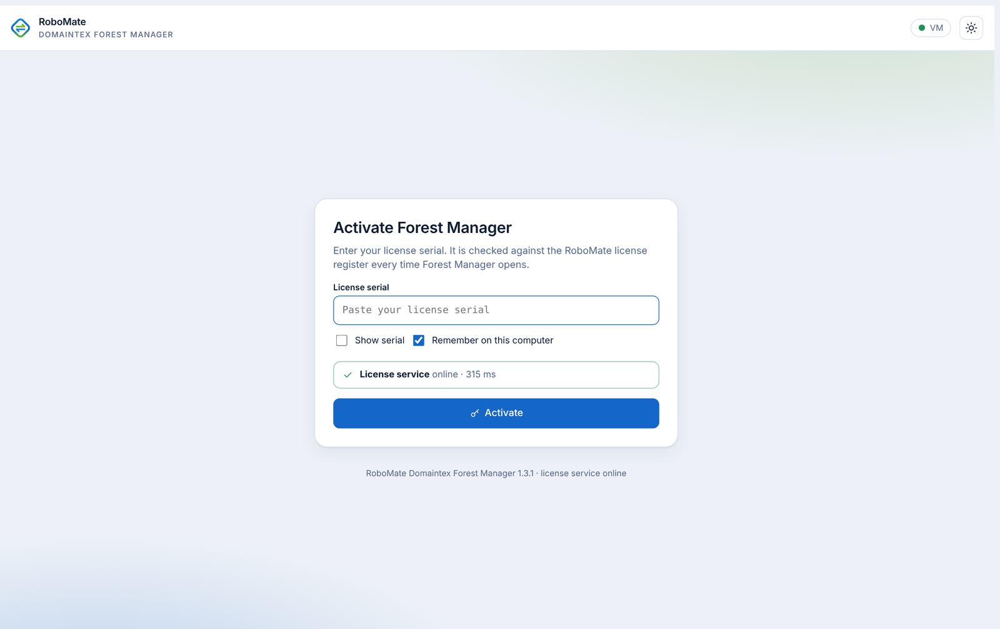
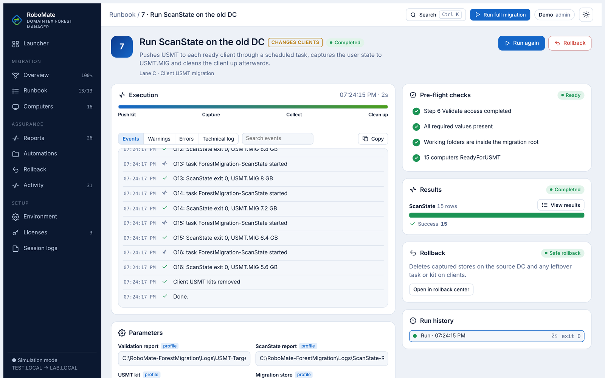
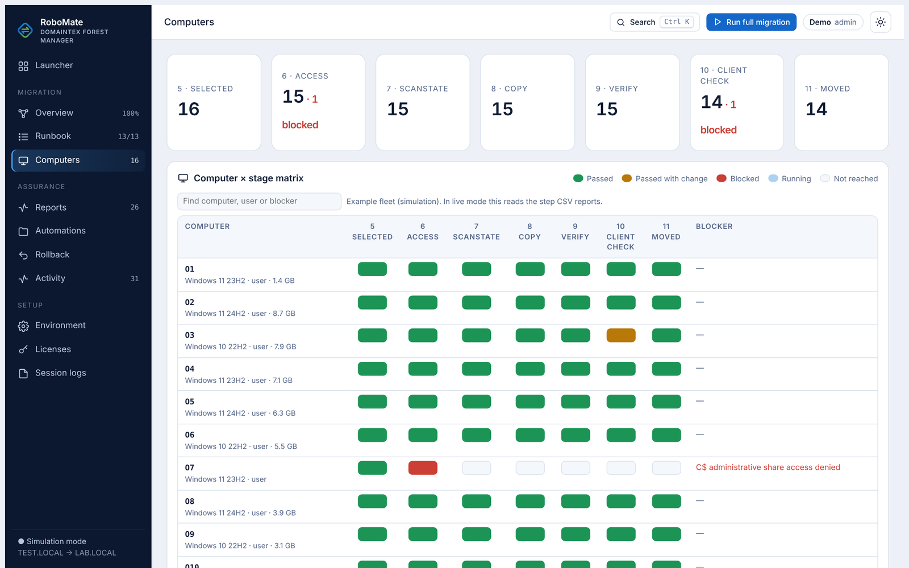
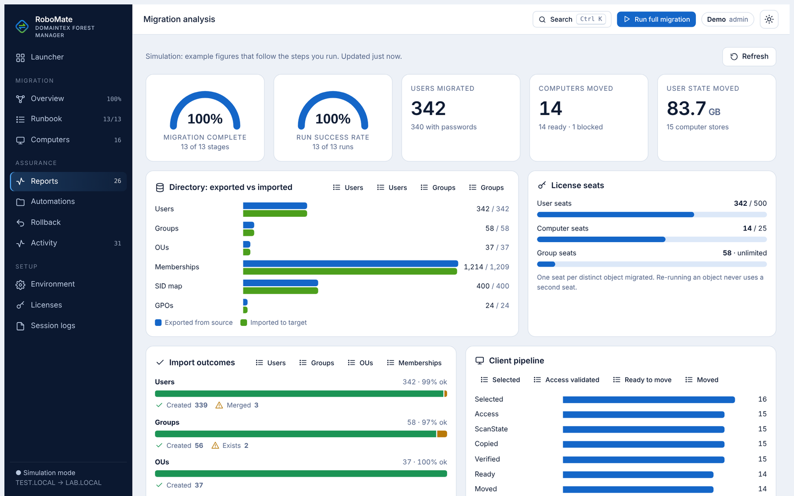
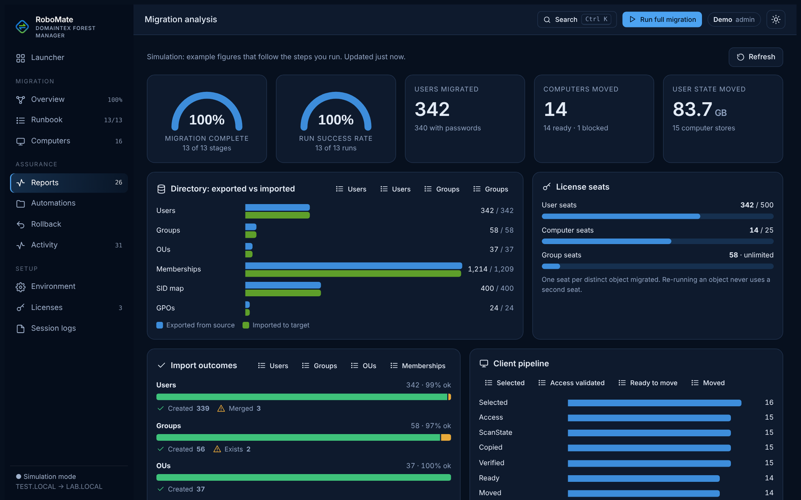
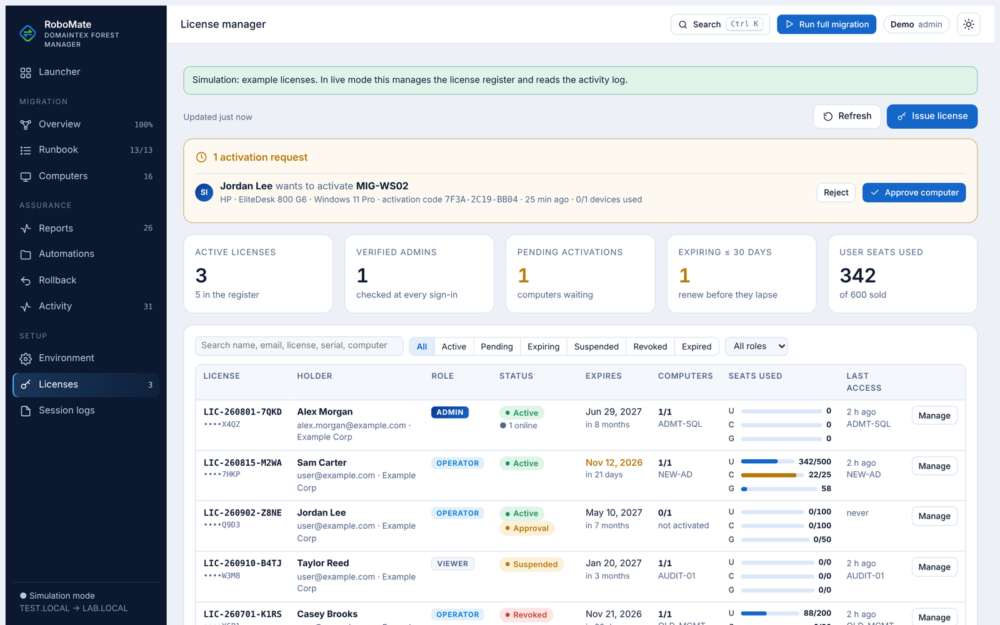
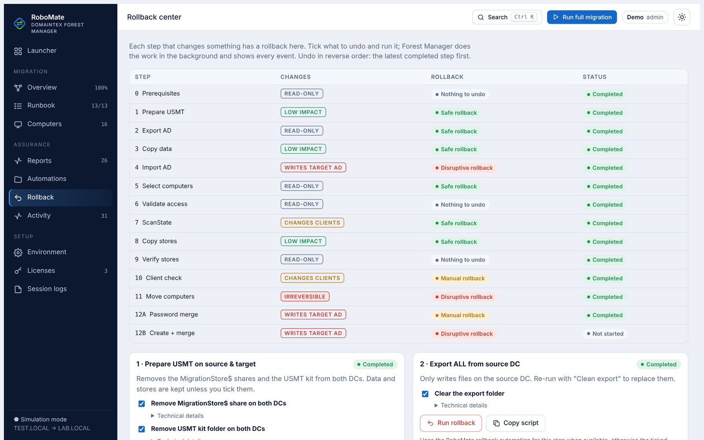
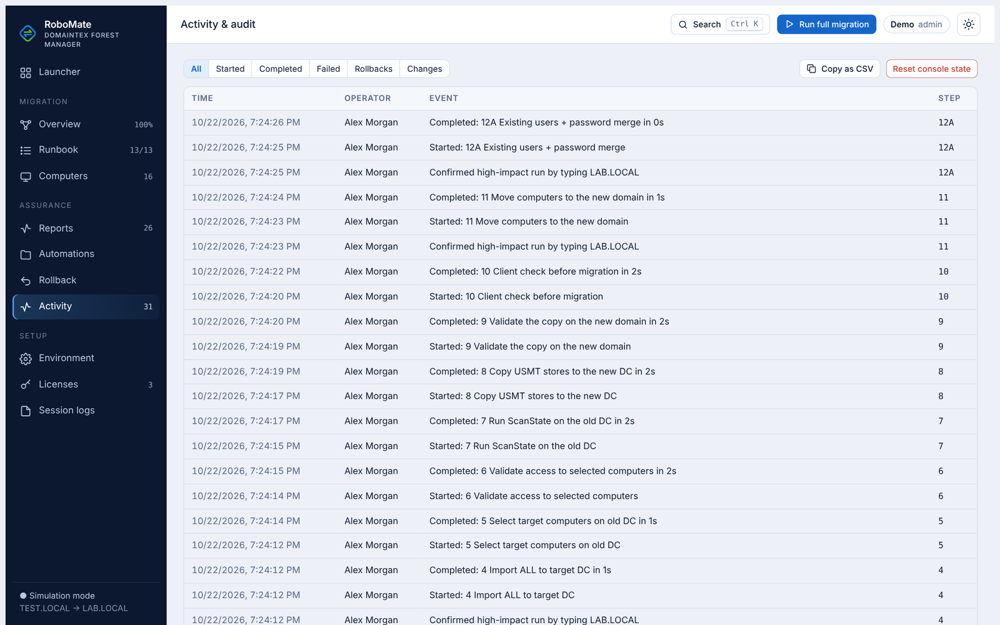

# RoboMate Domaintex Forest Manager

  

  <b>Cross-forest Active Directory migration, run from one console.</b> 
  Users, groups, OUs, Group Policy, passwords and computers, migrated step by step with live events, analysis reports and a rollback path for every change.

  
  
  
  
  

  <a href="#overview">Overview</a> ·
  <a href="#screenshots">Screenshots</a> ·
  <a href="#features">Features</a> ·
  <a href="#the-migration-runbook">Runbook</a> ·
  <a href="#system-requirements">Requirements</a> ·
  <a href="#installation">Installation</a> ·
  <a href="#licensing">Licensing</a> ·
  <a href="#security">Security</a> ·
  <a href="#support-and-contact">Contact</a>

---

## Overview

**RoboMate Domaintex Forest Manager** moves an organization from one Active Directory forest to another without command windows or scripts in front of the operator.

A Windows **launcher** runs the migration engine in the background, and the team works in a browser **console** at:

`http://RoboMateDomaintexForestManager:5090/`

Every migration step:

- **Checks its prerequisites before it starts** (pre-flight).
- **Runs unattended in the background** with the parameters set in the console.
- **Reports every event as it happens:** progress, warnings, errors and per-object results.
- **Writes results the console turns into data cards, gauges and bars.**
- **Has a rollback:** what each step changed, and how to undo it.

Operators never handle code, script files or file paths. Results open as tables inside the console.

  
   
  Migration overview: progress gauges, the four-lane topology and live status of all 13 stages (demo data).

## Screenshots

<table>
  <tr>
    <td width="50%">
      
       <b>Launcher</b>: start, stop and restart the engine, uptime gauge, service status and activity. No command window.
    </td>
    <td width="50%">
      
       <b>Activation</b>: the license is checked every time Forest Manager opens.
    </td>
  </tr>
  <tr>
    <td>
      
       <b>Step run</b>: pre-flight checks, stage progress, live event timeline, results and rollback.
    </td>
    <td>
      
       <b>Computers</b>: every client across selection, access, capture, copy, verification, readiness and move, with the blocker for each.
    </td>
  </tr>
  <tr>
    <td>
      
       <b>Analysis reports</b>: exported vs imported, import outcomes, client pipeline, seats and run durations.
    </td>
    <td>
      
       <b>Dark theme</b>: every view supports light and dark themes.
    </td>
  </tr>
  <tr>
    <td>
      
       <b>License manager</b> (verified administrators): roles, seats, computers, activation requests, expiry and status.
    </td>
    <td>
      
       <b>Rollback center</b>: what every step changes, its rollback level and the actions to undo it.
    </td>
  </tr>
  <tr>
    <td colspan="2">
      
       <b>Activity &amp; audit</b>: who ran what, when, against which domain, with confirmations for high-impact steps.
    </td>
  </tr>
</table>

Screenshots use demo data (example domains `TEST.LOCAL → LAB.LOCAL` and fictitious people).

## Features

| Area | What you get |
|---|---|
| **Guided runbook** | 13 stages in four lanes (pre-check, core AD, client USMT, users and passwords) with dependencies, "next up" guidance and one-click *Run lane* / *Run full migration*. |
| **No-code operation** | Steps run silently in the background from the parameters in the console. Operators see events, gauges and tables, never scripts or file paths. |
| **Live events** | Started, checks, warnings, errors and completion as a timeline. A per-step progress bar and stage tracker. The raw technical log is for verified administrators only. |
| **Pre-flight checks** | Required values, earlier steps, readiness lists and seat availability are checked before a step can start. |
| **Safety rails** | Risk labels on every step. Typed confirmation (the target domain name) for steps that write to the target or change clients. Pause after the current step. |
| **Analysis reports** | Data cards instead of file lists: migration and success gauges, exported vs imported bars, import outcomes, client pipeline, user-state sizes, readiness blockers, password migration, seats and run durations. |
| **In-console results** | Step outputs open as sortable tables inside the console when needed. No file browsing. |
| **Computer fleet** | Per-computer matrix across the seven client stages, with the exact blocker for every computer that cannot continue. |
| **Rollback center** | Every changing step documents its rollback level (safe, manual, disruptive) and the actions to undo it, runnable from the console. |
| **Activity & audit** | Encrypted audit trail of every run, confirmation, credential unlock and administrative action. |
| **Session logs** | Each session's events are collected and delivered to the license administrator when the session ends. Administrators read them in **Session logs**. |
| **Credential vault** | Source and target admin credentials are unlocked once per session and supplied to steps in memory only. Passwords are never written to disk. |
| **Desktop launcher** | Start, stop and restart with a graceful stop, uptime gauge, service and session tiles, an activity feed, the notification area and start with Windows. |
| **Themes & keyboard** | Light and dark themes, a `Ctrl+K` command palette and a responsive layout. |

## The migration runbook

| Lane | Step | Stage | Impact |
|---|---|---|---|
| A · Pre-check | 0 | Prerequisites: tooling, DNS, DC ports, credentials, forest trust, ADMT and Password Export Server | Read-only |
| B · Core AD | 1 | Prepare USMT on the source and target DCs (folders, USMT kit, protected store share) | Low |
| | 2 | Export everything from the source domain: OUs, users, groups, memberships, SID map, GPOs | Read-only |
| | 3 | Copy the export to the target DC and verify it | Low |
| | 4 | Import into the target: OUs, groups, users, managers, memberships, SID mapping, GPOs, links and security filtering | Writes target AD |
| C · Client USMT | 5 | Select the computers of the wave from the source OU | Read-only |
| | 6 | Validate access: DNS, ping, SMB, RPC, WinRM, admin share, OS, free space | Read-only |
| | 7 | Capture user state with USMT ScanState and collect the stores | Changes clients |
| | 8 | Copy the stores to the target DC with SHA-256 verification | Low |
| | 9 | Validate every store file by file | Read-only |
| | 10 | Final client readiness check: network, target DNS/LDAP, DHCP, store | Changes clients |
| | 11 | Move the computers to the new domain: join, restart, restore the full user state into fresh profiles | Irreversible |
| D · Users & passwords | 12A | ADMT password merge into the users created by step 4 | Writes target AD |
| | 12B | ADMT create-or-merge users of a source OU with password migration | Writes target AD |

The automation behind each step is delivered by RoboMate on demand and runs in memory, so updates reach every installation without reinstalling.

### Technology stack

| Component | Technology |
|---|---|
| Engine | ASP.NET Core 8 (minimal API), no third-party packages |
| Console | Single-page web app built into the engine, light/dark themes |
| Launcher | .NET 8 Windows Forms, runs elevated, notification-area icon |
| Automation | Windows PowerShell 5.1, ActiveDirectory and GroupPolicy modules, USMT, ADMT |
| Storage | `C:\RoboMate-ForestMigration\` (migration data). Program data encrypted under the install folder |

## System requirements

| | Requirement |
|---|---|
| **Migration server** | Windows Server 2016 or later (x64), usually the source DC or a member server with access to both forests |
| **Runtimes** | ASP.NET Core Runtime 8.x (x64) and .NET Desktop Runtime 8.x (x64) |
| **PowerShell** | Windows PowerShell 5.1 with RSAT Active Directory module and Group Policy Management |
| **Migration tools** | Windows ADK User State Migration Tool (USMT, amd64); ADMT 3.2 with the Password Export Server for password migration |
| **Network** | DNS, Kerberos, LDAP 389, ADWS 9389, SMB 445, RPC 135 and WinRM 5985 to both forests and the clients. Outbound HTTPS to the RoboMate license service |
| **Accounts** | An administrator of the source forest and of the target forest, unlocked in the console during a session |
| **Browser** | Current Microsoft Edge, Google Chrome or Firefox |
| **Rights** | The launcher runs as administrator (migration tasks need it; it also maps the console address to this computer) |

## Installation

1. Get the **App** package from [RoboMate](https://www.robomatecloud.com).
2. Unzip it to `C:\RoboMate-ForestMigration\Console\`.
3. Run **RoboMateForestManagerLauncher.exe** and accept the administrator prompt.
4. The launcher starts the engine, maps `RoboMateDomaintexForestManager` to this computer and shows its status.
5. Click **Open Forest Manager**, paste your **license serial** and press **Activate**.
6. Fill in **Environment** (domains, DCs, ADMT server, DNS servers, OUs), unlock the source and target credentials, then start with **Step 0 · Prerequisites**.

If the engine cannot start, the launcher explains why in plain words (missing runtime, port 5090 already in use, incomplete package, etc.) and offers **Copy details** for support.

## Licensing

Forest Manager is commercial software. Every installation needs a **license serial** issued by RoboMate or by your organization's license administrator.

| | |
|---|---|
| **Activation** | The serial is entered once per computer. A new computer sends an activation request that a license administrator approves, up to the license's device limit. |
| **Validation** | The license is checked at every sign-in and periodically during a session. Forest Manager does not open without a valid, active, unexpired license. A start-up connectivity check to the license service is required. |
| **Expiry** | Each license has an end date. The console warns before it expires. |
| **Roles** | **Administrator** (verified) · **Operator** · **Viewer**. See below. |
| **Seats** | Migration capacity per object type: **users**, **computers**, **groups** (or unlimited). One seat = one distinct object migrated; re-running the same object never uses another seat. A step is blocked before it starts when the license does not have enough seats left. |
| **Status** | Active, suspended or revoked. Suspending, revoking or moving a license to a new serial ends its sessions. |
| **Activity** | Sign-ins, runs, seat usage and session logs are recorded for each license and are visible to license administrators. |

### Roles

| Role | Can |
|---|---|
| **Administrator** | Everything an operator can do, plus the License manager, Session logs, Automation library and technical logs. Administrator rights are **verified at every sign-in**, not just declared in the license. |
| **Operator** | Run, retry, cancel and roll back steps; unlock credentials; view all reports. |
| **Viewer** | Read-only: progress, events and reports. |

### License manager (administrators)

Issue, renew, suspend, revoke and re-key licenses; set role, expiry, device limit and seats per object type; approve or reject computer activation requests; remove computers; see seat usage, last access, activity history and session logs.

For editions, seat packs and pricing, contact [RoboMate](https://www.robomatecloud.com).

## Security

- **Encrypted files.** Settings, license and activity records, session logs, console state, the audit trail and run logs are encrypted (AES-256-GCM, and Windows DPAPI for data bound to the computer). Files copied elsewhere are unreadable.
- **No automation on disk.** Step automation is delivered on demand, integrity-checked and run from memory. It is never stored on the server.
- **Credentials in memory only.** Unlocked credentials are kept in memory for the session and passed to steps without being written anywhere. Logs and the audit trail never contain passwords.
- **Least exposure.** The engine listens on the loopback address only and sends strict security headers (CSP, no framing, no referrer). Results are opened by report name; the console never accepts file paths from the browser.
- **Verified administration.** Administrator access is re-verified at every sign-in. Sessions are re-checked every few minutes and end when a license is suspended, revoked or re-keyed.
- **Protected client data.** User-state stores and client work folders are restricted to SYSTEM and Administrators.
- **Audit.** Every run, confirmation, credential unlock and administrative action is recorded with the operator, time and target.

## FAQ

<b>Does Forest Manager need internet access?</b>

Yes. The license is validated at every sign-in, and automation is delivered on demand. A start-up connectivity check runs before the console opens.

<b>Can we run part of the migration only?</b>

Yes. Run a single step, a lane, or the full migration. Lane C (clients) and lane D (users and passwords) are independent after their prerequisites.

<b>What happens if a step fails halfway?</b>

The step stops with the failing objects listed in its results. Fix the cause and run it again: completed objects are recognized, and seats are never counted twice. Every changing step has a documented rollback.

<b>Where do the results go?</b>

To `C:\RoboMate-ForestMigration\` on the migration server. The Reports page turns them into data cards, and each step's results open as tables in the console.

## Support and contact

  
  <b>RoboMate</b> 
  Website, licensing and support: <a href="https://www.robomatecloud.com"><b>www.robomatecloud.com</b></a>

 

For licensing questions, include your **license ID** (shown in the console's user menu). For start-up problems, include the launcher's **Copy details** output.

---

© 2026 RoboMate. All rights reserved. RoboMate Domaintex Forest Manager is commercial software licensed per installation. This repository contains documentation only. The software, its automation and license services are not open source and may not be copied, modified or redistributed without a written license from RoboMate. Microsoft, Windows, Active Directory, ADMT and USMT are trademarks of the Microsoft group of companies.
